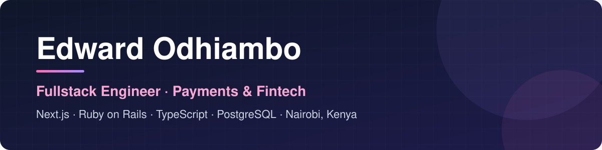

  

  

  
  
  

  I build payments products with Next.js, Ruby on Rails, TypeScript and PostgreSQL, 
  and I've been shipping web software full time since 2020. 
  Right now I build MulaFlow and UndaOS, Quikk API's merchant payments platform for Kenyan businesses.  
  Remote, Nairobi, or relocation to the EU · 30-day notice period

 

## What I've shipped

<table>
  <tr>
    <td align="center" width="25%"><h1>95%</h1>fewer payment errors after I rebuilt the ledger around idempotency keys and the outbox pattern</td>
    <td align="center" width="25%"><h1>5,000</h1>transactions in the first week on the M-Pesa and card collections I built end to end</td>
    <td align="center" width="25%"><h1>54%</h1>fewer reconciliation mismatches on those same collections</td>
    <td align="center" width="25%"><h1>40%</h1>faster onboarding after I replaced a sales-led process with self-serve provisioning</td>
  </tr>
</table>

I also built webhook delivery for integrators with retries, signed payloads, delivery logs and one-click replay. Before Quikk I worked with **Tetra Pak** (React and Rails, remote from Sweden), **Rift Koders** and **Smart People Africa**, and I've mentored 40+ Microverse students since 2022.

## Projects you can open

| | Project | Stack |
|---|---|---|
| 💳 | **[Stripelet](https://github.com/odhiambo-ed/rails_stripelet)** Stripe-style billing with subscriptions, invoices, a double-entry ledger and idempotent webhooks | Rails · PostgreSQL · Redis · Sidekiq |
| 💚 | **[HeartFund](https://github.com/odhiambo-ed/rails-quikk-heartfund-api)** Donation API with M-Pesa STK Push and HMAC-signed requests | Rails · PostgreSQL · RSpec · Docker |
| 👕 | **[ReUbuntu](https://re-ubuntu.vercel.app)** Retailers bulk-upload deadstock by CSV, auto-price it and list it to partners | Next.js · TypeScript · Supabase |
| 📊 | **[TransactiView](https://github.com/odhiambo-ed/react-supabase-transactiview-mpesa)** M-Pesa payments dashboard with STK Push, webhook confirmations and transaction history | React · Supabase · PostgreSQL |

## Stack

  

Also familiar with Kubernetes, AWS, Node.js and WebSockets.

 

Hiring for a fintech or product team? <a href="mailto:odhiambo.edward111@gmail.com">Send me an email</a>, I'd like to hear about it.

